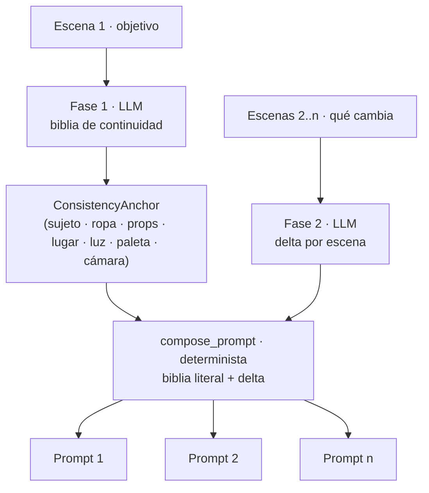

# Spec — Secuencia de n prompts con continuidad

Última modificación: 16-10-2026

Cómo se generan **n imágenes que parecen la misma secuencia** a partir de un
objetivo inicial y una lista de cambios. Documento de diseño: explica las reglas
y por qué son así.

---

## Problema

Pedir al LLM «genera 4 prompts de un chico que se despierta» produce cuatro
escenas con deriva: el pelo cambia de castaño a marrón, la habitación de los 90
se convierte en una moderna, la luz salta de sitio. La consistencia no se puede
delegar al modelo escena a escena.

## Solución: biblia fija + delta



**Decisión central:** los campos continuos se piden **una sola vez** y se
**reinyectan palabra por palabra**. Nunca se pide al modelo que los reescriba en
cada escena, porque parafrasear es garantía de deriva. El delta solo aporta
acción y, opcionalmente, los campos que de verdad cambian.

### Por qué no una sola llamada con todos los prompts

- Un JSON con n prompts convierte cada prompt en una paráfrasis independiente:
  es justo el mecanismo que produce la deriva.
- n llamadas pequeñas reintentan de forma natural: si la escena 4 falla, las
  demás siguen siendo válidas.
- El coste es n+1 llamadas; con backends de texto (sin imagen) es asumible.

---

## Campos

### Biblia (`ConsistencyAnchor`) — lo que debe ser idéntico

| Campo | Contenido | Ejemplo |
|-------|-----------|---------|
| `subject` | Sujeto único, con un solo referente nominal | `un chico de 17 años con pelo castaño revuelto` |
| `wardrobe` | Ropa y accesorios, con material | `camiseta gris de algodón, calzoncillos azules` |
| `props` | Objetos fijos del decorado | `un póster de Nirvana sobre la cama` |
| `setting` | Lugar y decorado | `habitación juvenil de los 90` |
| `lighting` | Dirección y calidad de la luz | `amanecer entrando por la ventana, contraluz suave` |
| `palette` | Paleta cromática | `tonos cálidos apagados, verdes de instituto` |
| `camera` | Óptica y encuadre | `plano medio, 35 mm, f/2.8` |

### Delta por escena (`SceneDelta`)

| Campo | Contenido |
|-------|-----------|
| `action` | Qué hace el sujeto **ahora** (obligatorio) |
| `props`, `lighting`, `palette`, `camera` | Override **opcional**: solo si ese aspecto cambia de verdad |

Los overrides vacíos heredan de la biblia. En el ensamblado, un override con
texto gana al campo continuo, así que la escena que cambia de encuadre o de luz
no repite el valor antiguo.

---

## Orden de ensamblado (dentro → fuera)

```text
subject, wardrobe, action, props, setting, lighting, palette, camera
```

La acción se intercala tras la ropa y antes del decorado: el sujeto y su aspecto
abren el prompt (donde el modelo da más peso), la escena y el envoltorio técnico
cierran. Es el orden de la estrategia «Dentro → fuera» ya usada en la pestaña.

Los segmentos repetidos se deduplican y el resultado termina en punto, así que
el prompt es autocontenido y pegable en txt2img sin editar.

---

## Reglas anti-deriva de los prompts del LLM

1. **Una sola llamada de biblia** con forma JSON explícita; el modelo inventa
   todo el detalle concreto que el usuario no dio.
2. **Prohibidas las palabras vacías** (`beautiful`, `realistic`, `cinematic`,
   `high quality`): se exige color, material, textura, cantidad, geometría,
   dirección de luz y focal.
3. **Un solo referente nominal** para el sujeto, reutilizado en las n escenas.
4. **Sin negativas** («no hay…», `without`): describir solo lo presente.
5. **El delta no re-describe la biblia**: se le pasa para contexto y se le
   prohíbe reescribirla. Si nombra al sujeto, debe usar el mismo sustantivo.
6. **Sin sujetos inventados** que el objetivo no implique.
7. El idioma de salida lo fija el selector de la pestaña (ES/EN).

---

## Degradación sin backend

Si la llamada de biblia falla, la secuencia **no se aborta**: cada prompt pasa a
`objetivo + cambio`. Es un suelo honesto:

- La continuidad de sujeto, lugar y luz se mantiene porque el objetivo se repite
  entero.
- La pega: la acción de la escena 1 viaja a todos los prompts y pueden mezclarse
  acciones. El aviso lo indica y la salida esperada es editar la biblia a mano y
  pulsar **Recomponer**.

Mismo comportamiento si la biblia llega vacía o ilegible.

---

## Recomposición sin LLM

`state_payload` guarda en un `gr.State` la biblia y, por escena, el delta
estructurado junto al texto de origen que escribió el usuario.

`recompose` reconstruye los n prompts sin llamar al modelo:

- Caja sin editar → se reutiliza el delta guardado (conserva overrides).
- Caja editada a mano → el delta pasa a ser la acción. Al escribir texto libre no
  hay forma de saber a qué campo pertenecía, así que se trata como acción: **lo
  que escribes es lo que sale**.

Esto convierte el ajuste fino en algo instantáneo y gratis: corregir «camiseta
gris» por «camiseta verde» en la biblia y recomponer actualiza los n prompts.

---

## Avisos de coherencia

`continuity_notes` no corrige; informa:

| Aviso | Cuándo |
|-------|--------|
| Biblia sobre presupuesto | La biblia supera el máximo de palabras del slider |
| Escena sin acción | Un delta se quedó vacío |
| Cambio redundante | El delta comparte ≥6 palabras de contenido con la biblia |
| Escenas casi idénticas | Solape Jaccard ≥0.9 entre prompts consecutivos |
| Solo una escena | No hay cambios: no hay secuencia |

---

## UI (pestaña Image → Prompt, acordeón «Secuencia»)

| Control | Función |
|---------|---------|
| **Escena 1 · objetivo** | Descripción de lo que se quiere conseguir |
| **Escena 2..n · qué cambia** | Solo el cambio; `+` / `−` añaden y quitan escenas |
| **Biblia de continuidad** | 7 campos editables; vaciarlos los excluye del prompt |
| **Longitud (palabras)** | Dos dual-range: biblia y cambio por escena |
| **Generar secuencia** | Fase 1 + fase 2 y ensamblado |
| **Recomponer (sin LLM)** | Reensambla con la biblia editada |
| **Los n prompts** | Salida completa; el `State` es la fuente de verdad |
| **Escena a enviar → Prompt** | Copia una escena al `prompt_out` de la pestaña |

El límite es `SEQ_MAX_SCENES = 12`; el recuento y las longitudes se guardan en
`ui_prefs.json`.

---

## Módulos

| Fichero | Rol |
|---------|-----|
| `forge_img2prompt/sequence.py` | Motor puro: DTOs, parseo tolerante, ensamblado, degradación, recomposición |
| `forge_img2prompt/vl_provider.py` | `QwenVLProvider.sequence` (transformer local, carga única) |
| `forge_img2prompt/ollama_vl.py` | `OllamaVLProvider.sequence` (+ `NanVLProvider` heredado) |
| `scripts/img2prompt.py` | Acordeón Gradio, handlers y wiring |
| `tests/test_sequence.py` | 33 tests del motor y los parseos |

El motor recibe un `run(system, user, max_tokens) -> str`, así que es agnóstico
del backend y se testea con un doble.
